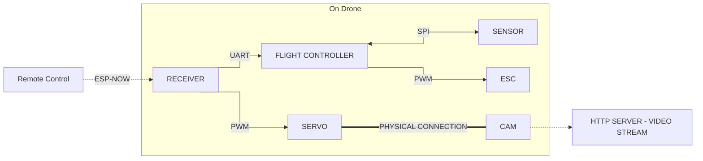

# multi-mcu-drone

#### Disclaimer
- Due to free profiles of HICPP and CPPCOREGUIDELINES in clang-tidy, this code is supposed to be taken as "HICPP-ish verified"
- **Current State:** Firmware is tested on hardware prototype (all that has been written to this day (**29 Oct 2026**)), custom PCB is being soldered, drone is being assembled

## System overview
This firmware is written primarily in C++. The general description of the software modules for each specific board is detailed below (**Detailed overview of mcus' firmwares can be found in respective README files in mcu specific folders**):

- [esp32c6-rc](esp32c6-rc/) - Remote control module; handles gamepad input and transmits data wirelessly to the drone via the ESP-NOW protocol.
- [esp32c6-receiver](esp32c6-receiver/) - Receiver module; captures ESP-NOW packets, forwards them to the [stm32f4-main](stm32f4-main/) module via UART, and generates PWM signal for camera servo control.
- [esp32s3-cam](esp32s3-cam/) - Camera module; handle streming video to http server as access point.
- [stm32f4-main](stm32f4-main/) - Flight controller; Main core of the drone. Runs a **completely custom-written HAL layer (bare-metal drivers, custom startup code, and explicit linker scripts)**. Calculates PID, handle motor mixer logic and generates high-frequency PWM duty cycles based on SPI-sampled IMU data (accelerometer/gyroscope).

## Data flow

## Third-party code
This project uses: 
- **[Bluepad32](https://github.com/ricardoquesada/bluepad32)** and its dependency **[BTStack](https://github.com/bluekitchen/btstack)** - Licensed under Apache 2.0 license
- **[FreeRTOS](https://github.com/freertos)** - Licensed under MIT license
- **STMicroelectronics System Files** ([stm32f4-main/src/syscalls.c](stm32f4-main/src/syscalls.c)): 
   Copyright (c) STMicroelectronics. Provided "AS-IS" under the vendor's standard 
   evaluation software license agreement terms embedded within the file header.
- **Espressif ESP-IDF Components & Camera SDK** - Licensed mostly under Apache 2.0 license

More about licensing and conditions in [LICENSE-3RD-PARTY](https://github.com/AlexWybranski/multi-mcu-drone/blob/master/LICENSE-3RD-PARTY.md)
